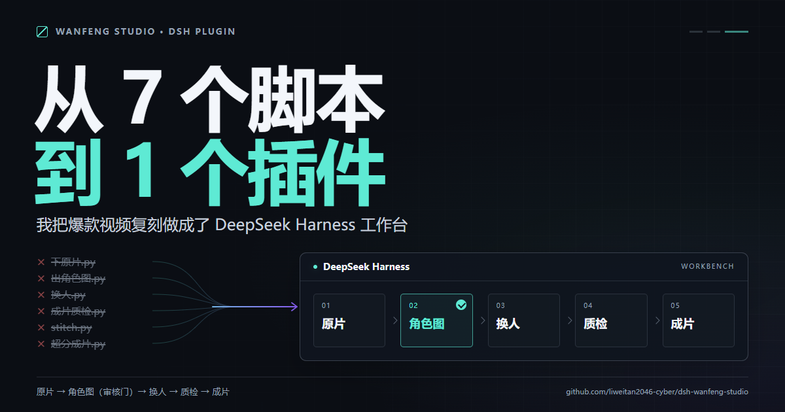
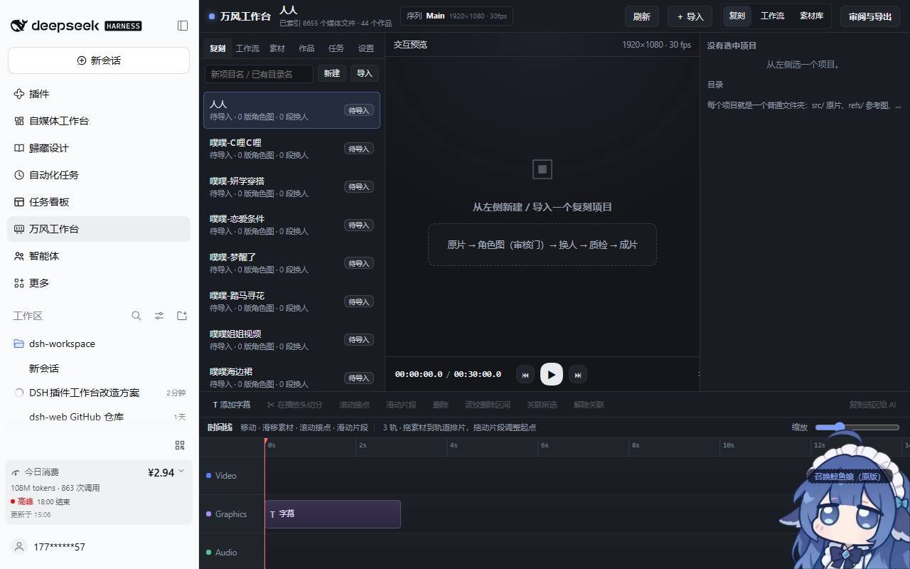
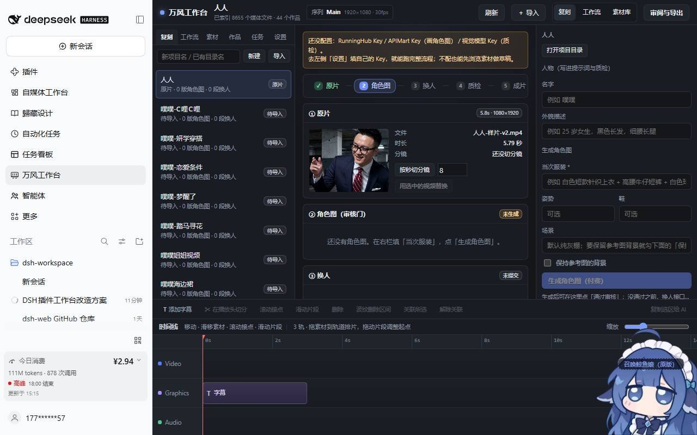
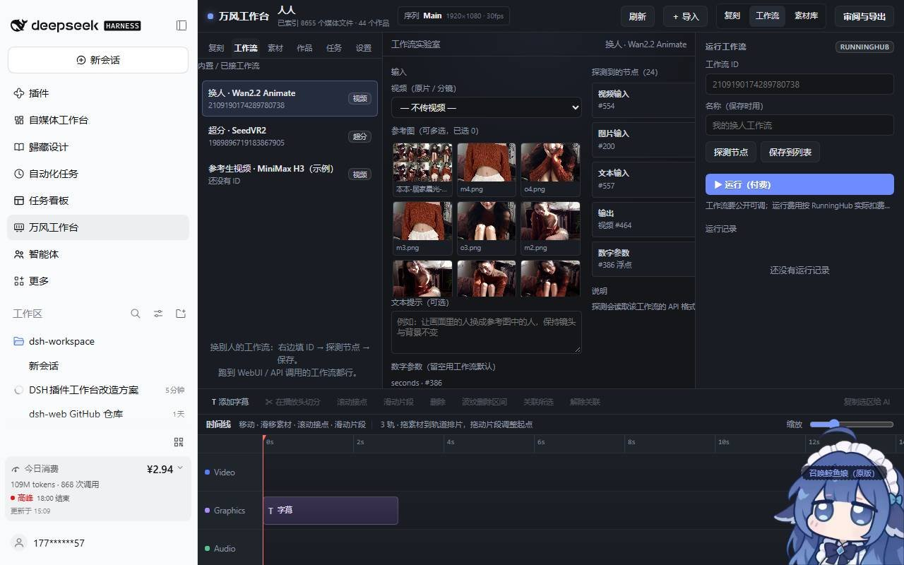
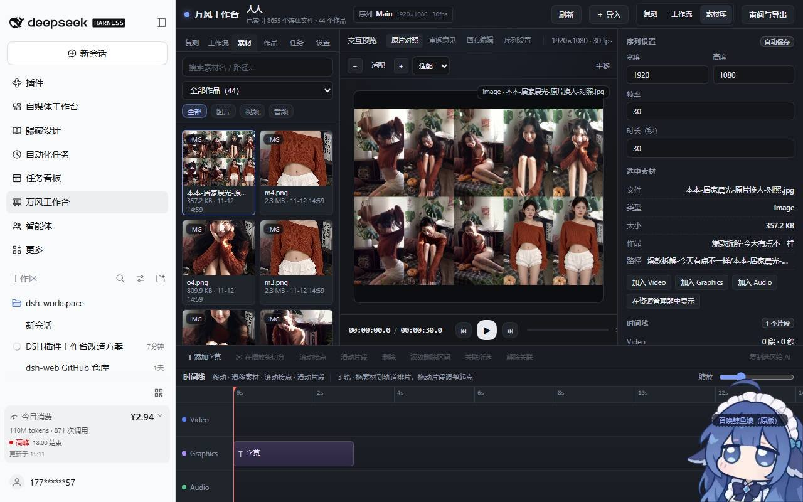
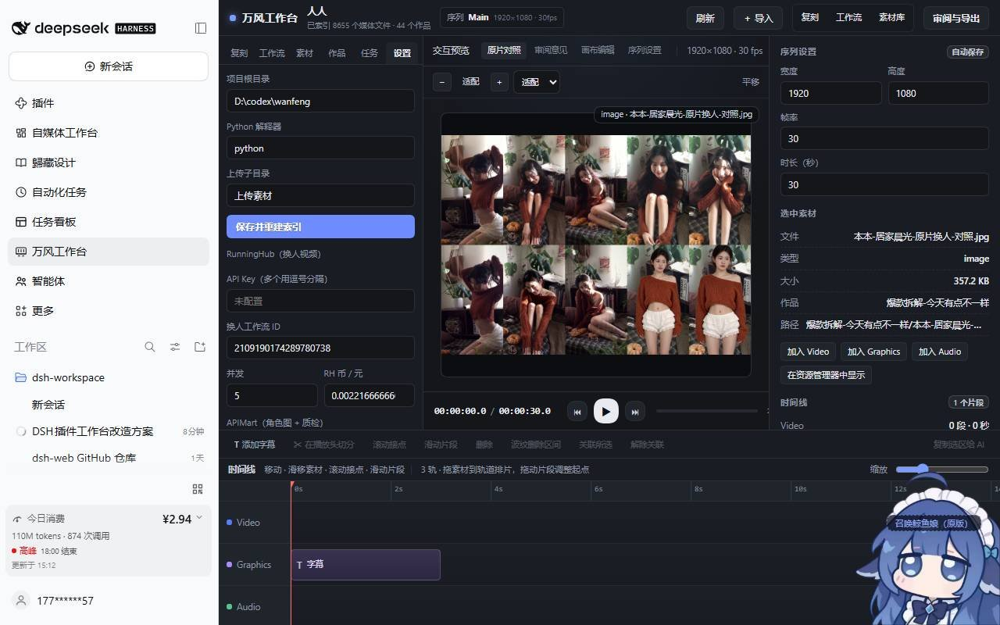

# 从 7 个脚本到 1 个插件：我把爆款视频复刻做成了 DeepSeek Harness 工作台

做 AI 视频的人，大部分时间根本不在生成。

在找文件。

原片在 A 文件夹，角色图在 B 文件夹，第 3 段的 take 叫 `s003_take2_ok.mp4`，质检报告是上上周的 `终检.json`，还有一个「这条到底审过没有」的问题，只能靠记忆回答。

我给自己这套爆款复刻流程数了一下：7 个 Python 脚本、3 家 API、1 道人肉审核门、45 个作品文件夹。

上周，我把它收进了一个侧栏入口。

> 配图 1 使用位置：开头第 4 段之后，用来承接「收进一个侧栏入口」这句话。想让人一眼看到「工作台」而不是「命令行」。

---

## 先说结论：复刻的瓶颈不在模型

这一年我换过三套换人方案，从生成式重演换到保背景的 Animate，模型能力每三个月跳一级。

但真正决定一条片子能不能出街的，从来不是模型。

是三件事：

1. 这条片子的第几个镜头，跑的是哪个任务，花了多少钱
2. 角色图是谁审的，审过没有，和这一版对不对得上
3. 质检说了什么，谁拍的板，为什么这次放行

这三件事，模型一件都不管。

它们属于流程。流程没有形状，就只能活在人的脑子里。

所以我把「工作台」和「工具」分得很清楚：

- 工具解决「能不能生成」
- 工作台解决「生成完了以后，它去了哪」

这一次我做的不是工具，是工作台。

---

## 五步，一步都不能少

一条复刻任务的形状，被我固定成五步：

原片 → 角色图 → 换人 → 质检 → 成片

> 配图 2 使用位置：这一节开头。它是全文的核心图，读者看完这张就知道五步是什么、每一步的输入输出在哪。

为什么是五步，不是三步，也不是一键到底。

因为每一段的产物，性质不一样：

- 原片是「事实」，它决定机位、节奏、背景
- 角色图是「资产」，它会被反复复用，也必须被审
- 换人是「消耗」，每一次都花钱
- 质检是「判断」，它决定这条能不能往下走
- 成片是「交付」，它只应该由通过质检的镜头拼出来

把不同性质的东西塞进一个按钮，最后一定会有一个环节靠人肉补。

人肉补的地方，就是事故现场。

---

## 第二步我故意做成了「跳不过去」

角色图这一版有一道硬门。

在界面上，它是右栏那个「生成角色图（付费）」和随后出现的「通过审核」。

在后端，它是一行判断：

没有 `approvedId`，或者版本状态不是 `ready`，

`POST /flow/swap/start` 直接返回 **403**。

不是灰按钮，不是提示语，是服务端拒绝。

> 配图 2 复用位置：这一节末尾。同一张图里，② 和 ③ 的相对位置正好说明「门」在哪一段之间。

为什么非要这么较真。

因为我踩过这个坑：

上一版角色图审过了，这一版换了服装，图像模型给的是一张「看起来还是她」的图。

人眼在缩略图上看不出来。

一晚上跑掉十几个镜头，第二天早上坐着看片，才发现主角的脸在 0:07 之后开始漂。

钱是小事。素材废掉、时间废掉、情绪废掉。

所以这道门的设计原则只有一条：

**默认不通过，只有人点过，才通过。**

AI 可以给你建议，但不给你放行权。

---

## 第 2.5 步：让别人也能用

工作台只服务我一个人，它就是个玩具。

要交给别人用，第一个问题是：他们的原片、他们的角色、他们的工作流，跟我完全不一样。

所以我在「五步」旁边开了一个侧面的入口：工作流实验室。

里面做了一件事：**你给我一个 RunningHub 的工作流 ID，我还你一套可填的输入。**

> 配图 3 使用位置：「让别人也能用」这一节的中段，正好对应「工作流 ID 变成输入」这个动作。

它的流程是四步：

1. 填工作流 ID
2. 点「探测节点」
3. 工具按 class_type 把节点分成视频输入、图片输入、文本、数字、输出，再按标题猜出 width / height / seed / seconds
4. 左边选素材，右边点运行

截图里那条内置工作流，探测出来是这样：

- 视频输入 `#554`
- 图片输入 `#200`
- 文本输入 `#557`
- 输出视频 `#464`
- 数字参数 `#386`

24 个节点，不用看那张满是连线的图。

这件事的意义不是「支持更多工作流」。

是**别人不需要懂你的工作流，也能用你的工作台**。

---

## 素材和时间线：让人愿意留下来

工作台最容易做错的地方，是只做「关键路径」。

关键路径是原片到成片。但人在真实工作里，80% 的动作发生在关键路径之外：

找一个上周的参考图、比两个版本的构图、把一段素材拖到第 12 秒看看节奏。

所以我顺手做了三件小事：

- 一个素材索引：8000+ 个媒体文件，44 个作品文件夹，按图片 / 视频 / 音频分好
- 一个三轨时间线：Video / Graphics / Audio，草稿自动存到 `.wanfeng-studio/timeline.json`
- 一个预览区：点中素材，中间立刻出画面，右栏出文件信息

> 配图 4 使用位置：「素材和时间线」这一节的结尾，承接「三件小事」。

这些功能不产生任何 AI 价值。

但它们决定了一件事：人愿不愿意每天打开它。

一个只能跑任务的窗口，人会在任务结束之后关掉。

一个能看片、能比对、能拖时间线的地方，人会一直开着。

---

## 让 API 归 API，让 Key 归用户

这套东西接了三家服务：RunningHub（换人和超分）、APIMart（画角色图）、视觉模型（质检）。

开源的时候有个原则：**不内置任何人的 Key，也不代付。**

所以「设置」这一栏被做成了第一屏就要面对的东西：

> 配图 5 使用位置：「让 API 归 API」这一节，说明配置是使用者自己的事。

几个取舍：

- Key 存在本地 `~/.dsh/wanfeng-studio/config.json`，不进仓库，`.gitignore` 直接挡住
- 设置页读出来的是打码版本，只看得到 `abcd••••wxyz`，看不到明文
- 没配 Key 的时候，工作台不假装能用：顶部一条黄条，明确写「还没配置 RunningHub Key / APIMart Key / 视觉模型 Key」
- 支持多 Key，逗号分隔，长任务优先调度，每个 Key 有并发上限，满了就排队

钱这件事也一样。

每一次换人和每一张角色图，结果里都会回填单次费用，界面上能直接看到这一条花了多少。

不是为了精确对账，是为了让你在按下「运行」之前，知道自己在按什么。

---

## 搭建过程中踩的四个坑

这部分是给同样在写 DSH 插件的人看的。不写方法论，只写事故。

**第一个坑：侧栏入口不是路由**

我一开始以为「加一个页面」是加一条路由。

实际上它是两个注册：在 `sidebar.panellist` 里注册一行，在 `main` 里用同一个 key 注册页面。

点侧栏那一行，layout 服务切到同名 key。少一个，点进去就是空白。

**第二个坑：主题变量会被宿主重写**

工作台是按深色做的，但宿主的「皮肤中心」会在运行中重写 `--dsw-alias-*` 这一组变量。

结果很诡异：卡片高度塌成 2px，输入框白底黑字，按钮变成黑块。

第一版我加 `!important`，不行。第二版我把 85 处变量全换成字面值，还是被刷。

最后是三层保险：字面值 + `!important` + 一个 MutationObserver 盯着 `input` / `select`，把颜色当场钉死。

**第三个坑：ESM 里不要 require**

插件是 ESM。`require('node:child_process')` 在顶层直接抛 `require is not defined`。

改成 `import { spawn } from 'node:child_process'` 就好。

低级的错，但报错信息不会告诉你「你写错模块系统了」。

**第四个坑：npm 的 2FA 比想象中硬**

发布那一步，`npm publish` 一直 403。

账号开了 2FA，方式是 security key。命令行不支持 security key，只会问 6 位码。

最后走的是 `npm stage publish`：命令行上传到暂存区，浏览器里点 Approve，浏览器原生支持 security key。

绕了一圈，反而找到了最稳的发版方式。

---

## 现在它是什么样

- 仓库：github.com/liweitan2046-cyber/dsh-wanfeng-studio
- npm：`dsh-wanfeng-studio@0.1.0`
- CI：Node 20 / 22 双矩阵，每次 21 项后端自测全过
- 安装：`plugin_manager(action="install_bundle", target="<目录>")`，刷新页面侧栏就多一行「万风工作台」

那 21 项测试里，有一项是专门测那道门的：

不带审核通过的版本去调换人接口，断言必须返回 403。

它绿的那一天，我比跑通生成还高兴。

因为这代表这个工作台不是「我记得要审」，而是「不审就跑不了」。

---

## 最后

做这个东西的过程中，我反复想起一句话：

文案决定别人愿不愿意读下去，内容决定别人愿不愿意留下来。

放到工具上是一样的：

**界面决定别人愿不愿意打开，流程决定别人敢不敢用。**

模型会继续变强，明年今天这套换人方案大概率已经过时。

但那道门、那五步、那个「先审再花钱」的顺序，会一直有用。

如果你也在做 AI 视频，或者也在把一堆脚本收拾成一个能交出去的东西，欢迎来仓库看看，也欢迎在评论区告诉我：

你那条流程里，哪一步是你死活不肯让 AI 自己决定的？

---

### 附：配图清单

| 编号 | 文件 | 内容 | 建议位置 |
| --- | --- | --- | --- |
| 1 | `01-reproduce.jpg` | 复刻 tab 首页，项目列表 + 画布 + 右栏 + 时间线 | 开头第 4 段后 |
| 2 | `05-project.jpg` | 五步 stepper + ② 角色图审核门 + ③ 换人未提交 | 「五步，一步都不能少」开头；「跳不过去」一节可复用 |
| 3 | `02-labs.jpg` | 工作流实验室，24 节点探测结果与输入映射 | 「让别人也能用」中段 |
| 4 | `03-assets.jpg` | 素材库卡片、预览、序列设置、三轨时间线 | 「素材和时间线」结尾 |
| 5 | `04-settings.jpg` | 设置页：根目录、Python、RunningHub / APIMart 配置 | 「让 API 归 API」一节 |